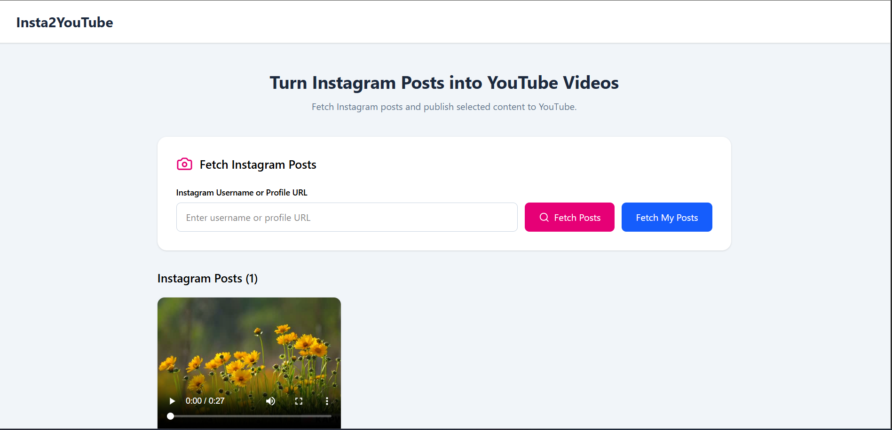
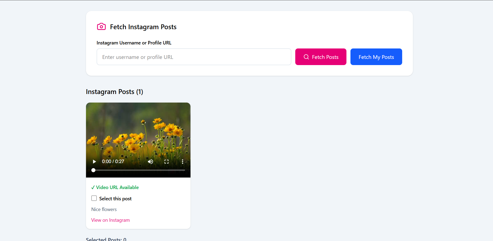
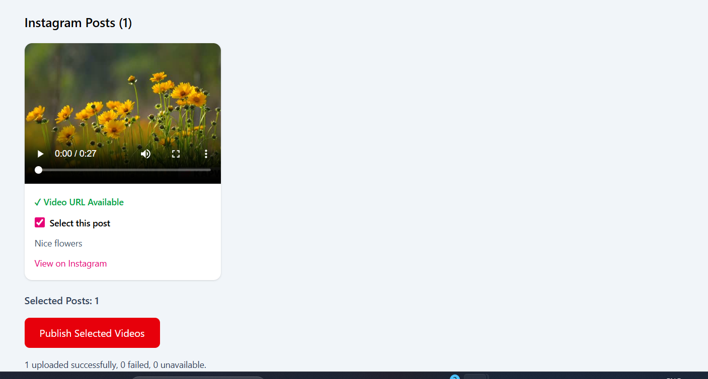
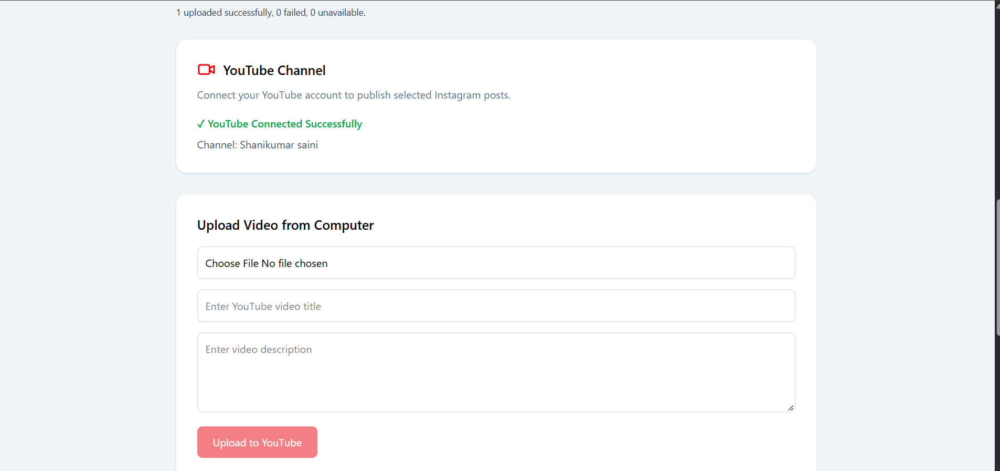
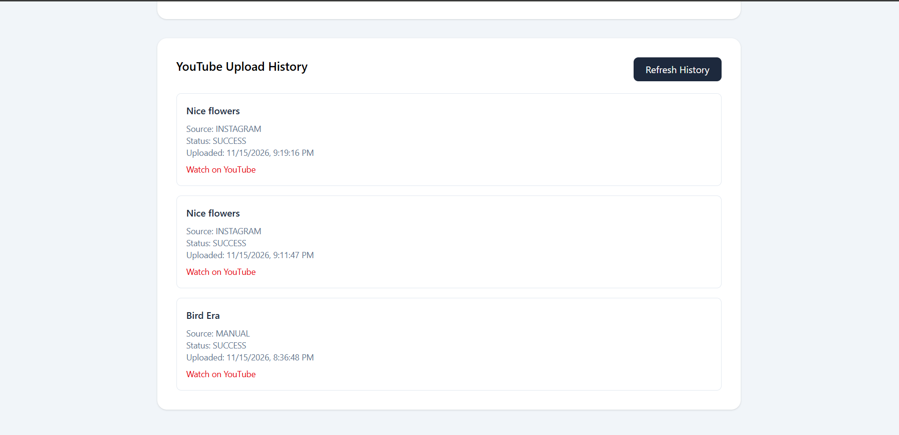

# Insta2YouTube – Instagram to YouTube Automation

A MERN stack web application that helps users fetch Instagram posts, select videos and upload them directly to their connected YouTube channel.

## Features

- Connect YouTube using Google OAuth 2.0.
- Fetch posts from your connected Instagram professional account.
- Fetch eligible public Instagram professional account posts.
- Preview Instagram images and videos.
- Select videos for YouTube publishing.
- Upload Instagram videos to YouTube.
- Store upload history in MongoDB.
- Display upload status and errors.

## Tech Stack

### Frontend
- React.js
- Vite
- Tailwind CSS
- Axios
- Lucide React

### Backend
- Node.js
- Express.js
- MongoDB
- Mongoose
- Google APIs
- Instagram Graph API
- Multer

## Project Structure


## Project Structure

```text
insta-youtube-automation/
│
├── backend/
│   ├── config/
│   ├── controllers/
│   ├── middleware/
│   ├── models/
│   ├── routes/
│   ├── services/
│   ├── uploads/
│   ├── server.js
│   ├── package.json
│   └── .env.example
│
├── frontend/
│   ├── public/
│   ├── src/
│   ├── package.json
│   └── index.html
│
├── screenshots/
│   ├── home.png
│   ├── instagram-posts.png
│   ├── video-selection.png
│   ├── youtube-connected.png
│   └── upload-history.png
│
├── .gitignore
└── README.md
```


## Installation

### 1. Clone the repository

git clone https://github.com/Shani-001/Insta2Youtube

cd insta-youtube-automation

### 2. Backend setup

cd backend

npm install

Create a `.env` file and configure your MongoDB, Instagram and Google OAuth credentials.

Start backend:

npm run dev

### 3. Frontend setup

Open another terminal:

cd frontend

npm install

npm run dev

## API Endpoints

| Method | Endpoint | Description |
|---|---|---|
| GET | /api/health | Check backend |
| POST | /api/instagram/fetch | Fetch public professional account posts |
| GET | /api/instagram/my-posts | Fetch your own Instagram posts |
| GET | /api/youtube/connect | Connect YouTube |
| GET | /api/youtube/callback | Google OAuth callback |
| POST | /api/youtube/upload | Upload a local video |
| POST | /api/youtube/upload-instagram | Upload an Instagram video |
| GET | /api/youtube/history | View upload history |

## Important Notes

- Instagram API access requires valid Meta credentials and permissions.
- Business Discovery supports eligible public professional Instagram accounts, not arbitrary public personal accounts.
- YouTube upload requires Google OAuth authorization.
- Instagram media URLs may expire, so videos should be uploaded promptly.
- Never commit `.env` files, OAuth credentials or access tokens.


## Application Screenshots

### 1. Home Page


### 2. Instagram Posts


### 3. Video Selection


### 4. YouTube Connection


### 5. Upload History



## Author

Shanikumar Saini

Computer Engineering Student
